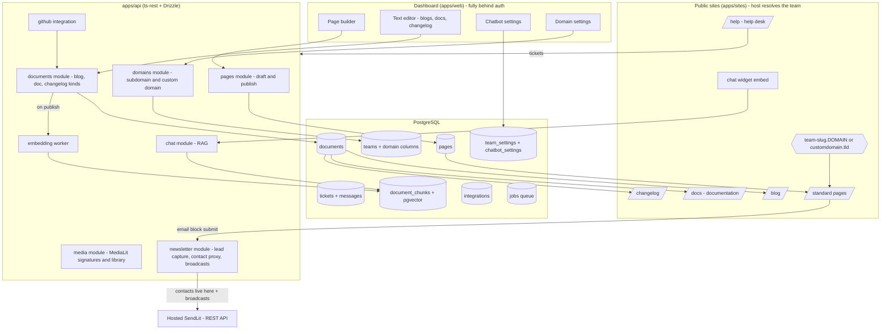
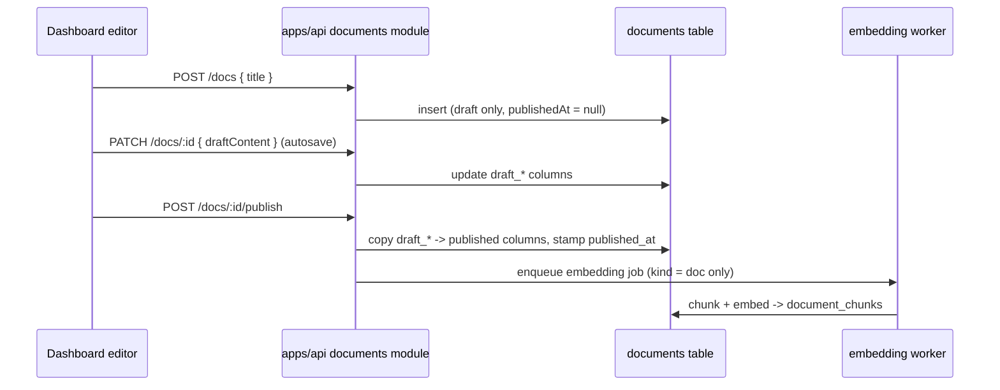
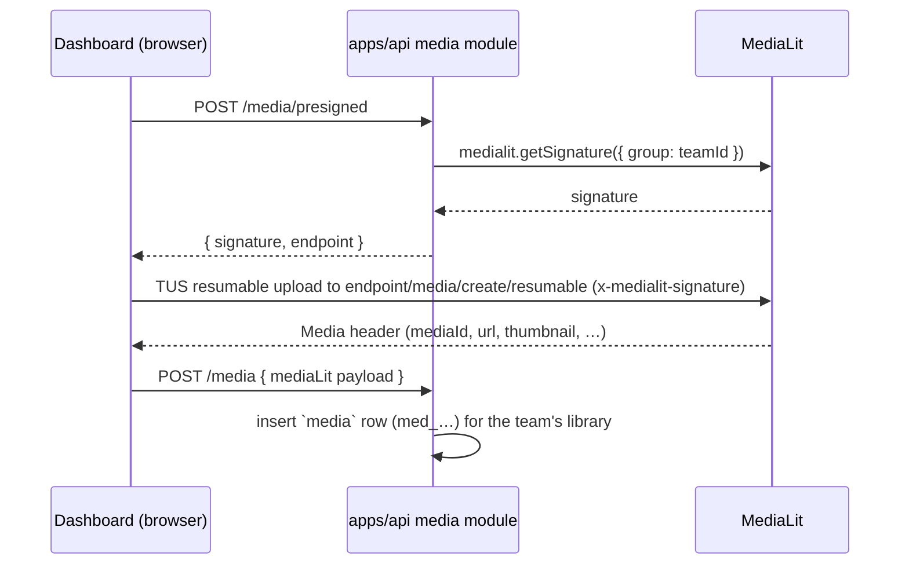

# FrontLit Architecture: Pages, Blog, Docs, Help Desk, Chatbot, Changelog & Newsletter

Status: **Proposed** · Last updated: 2026-07-16

This document designs the core content features of FrontLit — the "front
office of your SaaS": draft/publish pages, blog (`/blog`), documentation
(`/docs`) with pgvector-backed search, a help desk (`/help`), an
embeddable RAG chatbot, a changelog (`/changelog`) with GitHub
integration, and an email newsletter (lead capture on pages + sending via
the hosted SendLit REST API).

> **Route naming**: `/docs` hosts the documentation (help-center articles,
> vectorized for search/RAG); `/help` hosts the help desk (support
> tickets).

It follows the conventions already established in the repo:

- **API-first, MCP-ready**: every capability lands in `packages/api-contract`
  (ts-rest + zod) first, then `apps/api/src/<module>/{queries,routes}.ts`,
  then MCP tools in `apps/api/src/mcp/tools/`, then the dashboard UI in
  `apps/web`. **Nothing ships dashboard-only** — see §2 for the parity rule
  and the full endpoint ↔ tool matrix.
- **Multi-tenancy**: team scope is derived from auth context (`requireAuth` +
  `requireTeam`), never encoded in resource URLs. On the public side, the
  tenant is derived from the request **host**: every team gets
  `<team-slug>.<DOMAIN>` and can attach a custom domain (§12.1).
- **App split**: `apps/web` is the dashboard — every route behind auth
  except webhook handlers (§12.4). Public sites are served by a separate
  `apps/sites` Next.js app (§12.2).
- **IDs**: internal UUIDv7 `id` (never exposed) + public prefixed id
  (`pg_…`, `blog_…`) enforced with `publicIdCheck`.
- **Editing/rendering**: all *site* content rich text uses
  `@frontlit/text-editor` (TipTap JSON documents, rendered with its static
  `TextRenderer`). No markdown, no HTML storage. The one exception is
  newsletter emails, which use SendLit's email content model via
  `@sendlit/email-blocks` (§10.3).
- **Secure by default**: every public endpoint ships with its rate limits,
  CAPTCHA (public writes) and spend budgets (LLM paths) in the same
  milestone — the cross-cutting rules live in §13.

---

## 1. High-level shape



**Key decision — one authoring stack, three products.** Blog posts, help
docs and changelog entries are all "a rich-text document with a slug, a
draft state and a publish state". They share:

- a single Drizzle table (`documents`) with a `kind` discriminator
  (`blog | doc | changelog`),
- a single queries module implementing draft/publish/versioning,
- a single dashboard editor built on `@frontlit/text-editor`.

They differ only in kind-specific metadata (kept in typed columns + a
`meta` jsonb) and in their public REST surface, which is exposed as three
thin kind-scoped routers (`/blogs`, `/docs`, `/changelogs`) so the OpenAPI
spec and MCP tools stay self-explanatory for API consumers.

---

## 2. REST API & MCP parity (applies to every feature below)

Every feature in this document is a first-class API citizen. The invariant,
already established by the pages/teams/themes modules, is:

> **One capability = one queries function = one ts-rest endpoint = one MCP
> tool.** The dashboard UI is just another API consumer.

Mechanics (matching the existing code):

- All business logic lives in framework-agnostic
  `apps/api/src/<module>/queries.ts` functions, always `teamId`-scoped. REST
  handlers (`routes.ts`) and MCP tools (`mcp/tools/<module>.ts`) are both
  thin adapters over the *same* functions — no behavior drift possible.
- Zod schemas in `packages/api-contract` are shared verbatim across ts-rest
  validation, OpenAPI generation (`openapi.ts` → `apps/docs`), and MCP
  `inputSchema`/`outputSchema` (as `mcp/tools/pages.ts` already does with
  `pageSchema`).
- MCP tools follow the established conventions: `getTeamId(extra)` for team
  resolution, `jsonResult`/`AUTH_ERROR`/`NOT_FOUND`/`INTERNAL_ERROR` from
  `tools/responses.ts`, `omitInternal` + `serializeDates` serialization, and
  honest `annotations` (`readOnlyHint`, `destructiveHint`, `idempotentHint`).
- New tool modules are registered in `mcp/server.ts`'s `registerAllTools`,
  and the server `description` is extended to advertise the new
  capabilities.

### Endpoint ↔ tool matrix

| Feature | REST (team-scoped) | MCP tools |
|---|---|---|
| Pages (existing) | `POST/GET/PATCH/DELETE /pages…` | `list/create/get/update/delete_page` |
| Pages draft/publish (§4) | `POST /pages/:id/publish`, `POST /pages/:id/discard-draft` | `publish_page`, `discard_page_draft` |
| Blog (§5) | `POST/GET/PATCH/DELETE /blogs…`, `…/publish`, `…/discard-draft` | `list/create/get/update/delete_blog_post`, `publish_blog_post`, `discard_blog_post_draft` |
| Docs (§5) | `POST/GET/PATCH/DELETE /docs…`, `…/publish`, `…/discard-draft` | `list/create/get/update/delete_doc`, `publish_doc`, `discard_doc_draft` |
| Doc sections (§5) | `POST/GET/PATCH/DELETE /doc-sections…` | `list/create/update/delete_doc_section` |
| Docs search (§6) | `GET /docs/search?q=` (authed; public variant on `/public/…`) | `search_docs` (semantic search over published docs) |
| Changelog (§8) | `POST/GET/PATCH/DELETE /changelogs…`, `…/publish`, `…/discard-draft` | `list/create/get/update/delete_changelog_entry`, `publish_changelog_entry`, `discard_changelog_entry_draft` |
| GitHub import (§8) | `POST /changelogs/import-github` | `import_github_releases` |
| Chatbot settings (§7) | `GET/PATCH /chatbot` | `get_chatbot_settings`, `update_chatbot_settings` |
| Team settings (§12.5) | `GET/PATCH /settings` (branding + code injection) | `get_team_settings`, `update_team_settings` |
| Ask the docs (§7) | `POST /public/:teamId/chat` (public, SSE) | `ask_docs` (non-streaming RAG answer + cited sources) |
| Help desk (§11) | `GET /tickets`, `GET /tickets/:ticketId`, `POST /tickets/:ticketId/replies`, `POST …/status`, `POST …/assign` (submission is public: `POST /public/:teamId/tickets`) | `list_tickets`, `get_ticket`, `reply_to_ticket`, `set_ticket_status`, `assign_ticket` |
| Domains (§12.1) | `GET/PATCH /domain`, `POST /domain/custom`, `POST /domain/custom/verify`, `DELETE /domain/custom`, `POST /domain/primary` | `get_domain_settings`, `set_team_subdomain`, `attach_custom_domain`, `verify_custom_domain`, `remove_custom_domain`, `set_primary_domain` |
| Media (§9) | `POST /media/presigned`, `POST /media`, `GET/PATCH/DELETE /media…` | `get_media_upload_signature`, `register_media`, `list_media`, `get_media`, `update_media`, `delete_media` |
| Contacts (§10.2, read-through to SendLit) | `GET /contacts` (with filter params), `GET/DELETE /contacts/:contactId`, `POST/DELETE /contacts/:contactId/tags/:tag` (capture itself is public: `POST /public/:teamId/leads`) | `list_contacts`, `get_contact`, `delete_contact`, `add_contact_tag`, `remove_contact_tag` |
| Segments (§10.2, read-through to SendLit) | `GET/POST/PATCH/DELETE /newsletter/segments…` | `list_segments`, `create_segment`, `update_segment`, `delete_segment` |
| Newsletter (§10.3) | `GET/PATCH /newsletter`, `GET/POST/PATCH /newsletter/broadcasts…`, `POST …/send`, `GET …/stats` | `get/update_newsletter_settings`, `list/create/update/send_broadcast`, `get_broadcast_stats` |

Notes:

- Since blogs/docs/changelogs share one engine (§5), their REST routers
  *and* MCP tool registrations come from the same per-kind factory.
  Kind-named tools (`create_blog_post`, not a generic `create_document`
  with a `kind` arg) keep the tool list self-describing for agents at
  near-zero marginal code cost.
- Rich-text arguments: create/update endpoints and tools accept `content`
  as TipTap JSON (`TextEditorContent`). Tool descriptions document the
  shape so agents can author content directly; input is normalized
  server-side (`normalizeTextEditorContent`) in the shared queries layer,
  identically for REST and MCP.
- `ask_docs` and `search_docs` make the documentation itself
  agent-consumable — a customer's support agent (or FrontLit's own MCP
  clients) can answer questions from the vectorized docs without the web
  widget.

**Definition of done for every milestone in §15:** contract + routes +
regenerated OpenAPI + MCP tools + `apps/docs` REST reference updated +
vitest coverage per §14. An endpoint without its MCP twin is an incomplete
feature.

---

## 3. Draft/publish model

We adopt CourseLit's proven page model (`courselit/apps/web/models/Page.ts`):
each publishable entity carries **both** its published fields and parallel
`draft*` fields in the same row.

- Every edit (builder autosave, editor save, SEO change) writes **only** the
  `draft*` fields.
- `POST …/:id/publish` copies draft → published in one transaction and stamps
  `publishedAt`.
- `POST …/:id/discard-draft` copies published → draft (revert).
- Public rendering reads published fields only; the dashboard reads drafts.

Why not a separate revisions table? A two-state model covers the actual
product need (edit safely, then promote), keeps queries trivially cheap, and
matches how CourseLit has run this in production. A `document_revisions`
audit table can be layered on later without changing the API surface.

Derived status (not stored, computed in serializers):

| status | condition |
|---|---|
| `draft` | never published (`publishedAt IS NULL`) |
| `published` | published and draft == published |
| `published+changes` | published and draft differs (`hasUnpublishedChanges`) |

---

## 4. Pages

### 4.1 Schema changes (`apps/api/src/db/schema.ts`)

Extend the existing `pages` table:

```ts
export const pages = pgTable("pages", {
    // …existing columns (published side): layout, title, description,
    // socialImage, robotsAllowed …
    slug: text("slug").notNull(),               // route on the public site
    deleteable: boolean("deleteable").notNull().default(true),
    draftLayout: jsonb("draft_layout").$type<WidgetInstanceRow[]>().notNull().default([]),
    draftTitle: text("draft_title"),
    draftDescription: text("draft_description"),
    draftSocialImage: jsonb("draft_social_image").$type<Record<string, unknown>>(),
    draftRobotsAllowed: boolean("draft_robots_allowed"),
    publishedAt: timestamp("published_at"),
}, (table) => [
    uniqueIndex("pages_team_slug_idx").on(table.teamId, table.slug),
    // …existing indexes
]);
```

### 4.2 Standard pages

Seeded per team at provisioning time (`provisioning/routes.ts` +
`teams/queries.ts` `createTeam`), all `deleteable: false`:

| name | slug | type | notes |
|---|---|---|---|
| Homepage | `` (empty) | `site` | root of the public site |
| Blog | `blog` | `blog` | index shell; post list is a builder block |
| Changelog | `changelog` | `custom` | entry list is a builder block |
| Docs | `docs` | `custom` | doc nav/search is a builder block |
| Help desk | `help` | `custom` | `support-form` block pre-placed (§11.2) |
| Terms of Service | `terms` | `custom` | |
| Privacy policy | `privacy` | `custom` | |

Standard pages are ordinary pages — same builder, same draft/publish flow —
they just can't be deleted and their slugs are reserved. `blog`, `docs`,
`changelog` and `help` pages ship with the corresponding list/nav/form
blocks pre-placed in their layout so the sections work out of the box.

### 4.3 Contract & routes

`packages/api-contract/src/schemas/pages.ts`:

- `pageSchema` gains `slug`, `deleteable`, `publishedAt`, `hasUnpublishedChanges`,
  and `draftLayout`/`draftTitle`/`draftDescription`/`draftSocialImage`/`draftRobotsAllowed`.
- `updatePageBodySchema` keeps its current fields but the handler writes them
  to the **draft** columns (this is a behavior change for `PATCH /pages/:pageId`).

New endpoints in `contract.pages`:

| method & path | purpose |
|---|---|
| `POST /pages/:pageId/publish` | promote draft → published |
| `POST /pages/:pageId/discard-draft` | reset draft to published state |

Update `apps/api/src/mcp/tools/pages.ts`, `openapi.ts` output and
`apps/docs` accordingly.

### 4.4 Migration

One-off Drizzle migration: add columns, then backfill
`draft_layout = layout`, `draft_title = title`, … and `published_at =
updated_at` for existing rows (existing pages are considered published),
and generate slugs from names (with the standard-page slugs reserved).

---

## 5. Documents: the shared blog / docs / changelog engine

### 5.1 Schema

```ts
export const documentKinds = ["blog", "doc", "changelog"] as const;

export const documents = pgTable("documents", {
    id: text("id").primaryKey().$defaultFn(genId),
    documentId: text("document_id").notNull().unique()
        .$defaultFn(() => genPublicId("doc")),        // doc_…
    teamId: text("team_id").notNull()
        .references(() => teams.id, { onDelete: "cascade" }),
    kind: text("kind", { enum: documentKinds }).notNull(),
    slug: text("slug").notNull(),

    // published side (public site + public API read these)
    title: text("title"),
    content: jsonb("content").$type<TextEditorContent>(),   // TipTap JSON
    excerpt: text("excerpt"),
    featuredImage: jsonb("featured_image").$type<Record<string, unknown>>(),
    meta: jsonb("meta").$type<Record<string, unknown>>().notNull().default({}),

    // draft side (dashboard edits these)
    draftTitle: text("draft_title").notNull(),
    draftContent: jsonb("draft_content").$type<TextEditorContent>().notNull(),
    draftExcerpt: text("draft_excerpt"),
    draftFeaturedImage: jsonb("draft_featured_image").$type<Record<string, unknown>>(),
    draftMeta: jsonb("draft_meta").$type<Record<string, unknown>>().notNull().default({}),

    authorAccountId: text("author_account_id")
        .references(() => accounts.id, { onDelete: "set null" }),
    publishedAt: timestamp("published_at"),
    createdAt: timestamp("created_at").notNull().defaultNow(),
    updatedAt: timestamp("updated_at").notNull().defaultNow(),
}, (table) => [
    uniqueIndex("documents_team_kind_slug_idx").on(table.teamId, table.kind, table.slug),
    index("documents_team_kind_idx").on(table.teamId, table.kind),
    index("documents_published_idx").on(table.teamId, table.kind, table.publishedAt),
    publicIdCheck("document_id", "doc"),
]);
```

Kind-specific `meta` (validated per-kind by zod in the contract, stored as
jsonb so the core engine stays generic):

| kind | meta fields |
|---|---|
| *all kinds* | `seo?: { title?, description? }` — optional overrides for public metadata (§12.3) |
| `blog` | `tags: string[]` |
| `doc` | `sectionId: string`, `order: number` (help-center nav tree) |
| `changelog` | `version?: string`, `labels: ("added"\|"fixed"\|"improved"\|"removed")[]`, `releaseDate: string`, `github?: { releaseId, tag, htmlUrl }` |

Help-center sections get a small companion table:

```ts
export const docSections = pgTable("doc_sections", {
    id, sectionId /* sec_… */, teamId, name, slug, order, createdAt, updatedAt,
});
```

Deletion/cleanup: `documents` and `doc_sections` cascade on team delete;
deleting a document (or unpublishing a `doc`) deletes its `document_chunks`
rows (§6) in the same transaction.

### 5.2 Authoring flow (identical for all three kinds)



`draftContent` is a `TextEditorContent` (TipTap JSON) produced by
`@frontlit/text-editor`'s `Editor`; `emptyDoc` seeds new documents and
`normalizeTextEditorContent` sanitizes on write. `excerpt` defaults to
`truncateTextEditorContent(content)` at publish time when not set manually.

### 5.3 Contract & routes

One implementation, three surfaces. `apps/api/src/documents/queries.ts`
holds all logic (create/list/get/update/publish/discard/delete, always
`(teamId, kind)`-scoped). `packages/api-contract` exposes:

- `contract.blogs` → `/blogs`, `/blogs/:documentId`, `…/publish`, `…/discard-draft`
- `contract.docs` → `/docs` (+ `/doc-sections` CRUD)
- `contract.changelogs` → `/changelogs` (+ `/changelogs/import-github`, §8)

built from a shared `makeDocumentContract(kind, metaSchema)` factory in
`schemas/documents.ts`, so schemas stay DRY while the OpenAPI docs show
concrete, kind-named endpoints. Matching MCP tools:
`mcp/tools/{blogs,docs,changelogs}.ts` via a similar factory.

### 5.4 Public read API

Public site rendering (and any headless consumer) needs unauthenticated,
published-only reads. Add a `public` contract group, resolved by team
public id (no session/API key; rate limits, CAPTCHA and budgets per §13):

| endpoint | serves |
|---|---|
| `GET /public/resolve-host?host=` | host → team resolution for `apps/sites` + TLS "ask" (§12) |
| `GET /public/:teamId/settings` | branding (title, subtitle, logo/favicon) + code-injection snippets for the site shell (§12.5) |
| `GET /public/:teamId/pages/:slug` | published page layout for the renderer |
| `GET /public/:teamId/blogs` / `…/blogs/:slug` | `/blog` index + post pages |
| `GET /public/:teamId/docs` / `…/docs/:slug` | `/docs` nav tree + doc pages |
| `GET /public/:teamId/changelogs` | `/changelog` feed |
| `GET /public/:teamId/sitemap` | all published, robots-allowed URLs + `lastmod` — feeds sitemap.xml and RSS generation (§12.3) |
| `POST /public/:teamId/leads` | email-form block submissions → queued sync to SendLit contacts (§10.2) |
| `POST /public/:teamId/tickets`, `GET/POST …/tickets/:ticketId/messages` | help-desk submission + magic-token thread (§11) |
| `POST /public/:teamId/chat` (SSE) | chatbot (§7) |

These return published fields only and never leak `draft*` columns
(enforced in the serializer next to `omitInternal`).

---

## 6. Documentation vectorization (pgvector)

### 6.1 Infrastructure

- `docker-compose.yml`: switch image to `pgvector/pgvector:pg16`.
- Migration: `CREATE EXTENSION IF NOT EXISTS vector;`
- New dependency in `apps/api`: the `ai` SDK (or plain fetch) for the
  embeddings API. Provider/model/keys via env:
  `EMBEDDINGS_PROVIDER`, `EMBEDDINGS_MODEL` (default
  `openai / text-embedding-3-small`, 1536 dims), `OPENAI_API_KEY`.

### 6.2 Schema

```ts
export const documentChunks = pgTable("document_chunks", {
    id: text("id").primaryKey().$defaultFn(genId),
    teamId: text("team_id").notNull()
        .references(() => teams.id, { onDelete: "cascade" }),
    documentId: text("document_id").notNull()
        .references(() => documents.id, { onDelete: "cascade" }),
    heading: text("heading"),          // nearest heading, for citations
    anchor: text("anchor"),            // #fragment on /docs/:slug
    content: text("content").notNull(),// plain text of the chunk
    embedding: vector("embedding", { dimensions: 1536 }).notNull(),
    createdAt: timestamp("created_at").notNull().defaultNow(),
}, (table) => [
    index("document_chunks_team_idx").on(table.teamId),
    index("document_chunks_embedding_idx")
        .using("hnsw", table.embedding.op("vector_cosine_ops")),
]);
```

### 6.3 Chunking & indexing pipeline

On **publish** of a `doc` (never on draft saves):

1. Split the published `TextEditorContent` at headings using
   `extractHeadings` + `extractTextFromNode` from `@frontlit/text-editor`;
   merge/split sections into ~200–500-word chunks with one-sentence overlap.
2. Embed chunks in one batched provider call.
3. In a transaction: delete the document's old chunks, insert new ones.

On unpublish/delete: delete chunks (plus FK cascade as backstop).

Jobs live in a tiny pg-backed queue (a generic `jobs` table with a `type`
column: pending → processing → done/failed/dead with attempt count;
workers claim rows with `FOR UPDATE SKIP LOCKED`, §13.5), drained by an
interval worker started from `apps/api/src/index.ts`. No Redis; publish
latency stays low and failures are retryable and observable. The same
queue serves contact sync (§10.2), domain verification (§12.1),
ticket-notification emails (§11.2), changelog imports and any other async
work.

### 6.4 Retrieval

`searchChunks(teamId, queryEmbedding, k = 6)`: cosine distance over the HNSW
index, `WHERE team_id = …`, with a similarity floor (~0.25) to avoid feeding
garbage to the LLM. Also reused for `/docs` search-as-you-type
(`GET /public/:teamId/docs/search?q=`) and the help desk's deflection
suggestions (§11.2).

---

## 7. Chatbot (RAG, embeddable)

### 7.1 Settings

```ts
export const chatbotSettings = pgTable("chatbot_settings", {
    id: text("id").primaryKey().$defaultFn(genId),
    teamId: text("team_id").notNull().unique()
        .references(() => teams.id, { onDelete: "cascade" }),
    enabled: boolean("enabled").notNull().default(false),
    name: text("name").notNull().default("Assistant"),
    greeting: text("greeting"),
    accentColor: text("accent_color"),
    createdAt / updatedAt,
});
```

Contract: `contract.chatbot` — `GET /chatbot` / `PATCH /chatbot`
(team-scoped), managed from a dashboard settings screen. LLM provider/model
are server env config (`CHAT_MODEL`, default `gpt-4o-mini`-class), not
per-team, until pricing/plans demand otherwise.

### 7.2 Chat endpoint

`POST /public/:teamId/chat` (SSE streaming; rate-limited per IP+team
**and** capped by a per-team daily token budget — §13.2):

1. Reject if chatbot disabled for the team.
2. Embed the user message (last user turn; client sends bounded history).
3. `searchChunks(teamId, …)` → top-k chunks.
4. Prompt: system instructions ("answer only from the provided help
   articles; say you don't know otherwise") + chunks with their
   `/docs/:slug#anchor` source URLs + chat history.
5. Stream tokens; finish with a `sources` event listing cited articles.

No server-side conversation persistence in v1 (history lives in the widget's
`sessionStorage`). A `chat_conversations` table is a natural v2 for
analytics and "escalate to support".

### 7.3 Embedding on sites

- **FrontLit-hosted pages**: when `chatbotSettings.enabled`, the public site
  layout renders the floating chat widget automatically on every page.
- **External sites**: `<script src="https://<team-host>/embed/chat.js">`
  — a tiny loader served by `apps/sites` (§12.2; the snippet uses the team's
  primary host, so the team is implied by the host — no `data-team`
  attribute needed) that mounts a floating button opening an iframe
  (`/embed/chat`, same host), which hosts the actual React chat UI and
  talks to the public chat endpoint. The iframe isolates styles and keeps
  the loader ~1 KB. It never touches `apps/web`, which stays fully behind
  auth (§12.4).

---

## 8. Changelog & GitHub integration

Changelog entries are `documents` with `kind: "changelog"` — the whole
draft/publish/authoring stack comes for free. `/changelog` renders the
published feed (grouped by month, label badges, optional version tags), plus
an RSS feed at `/changelog/rss.xml` served by `apps/sites` (§12.3).

### 8.1 GitHub integration (standard path)

Per-team connection stored in a generic `integrations` table
(`provider = "github"`, encrypted `config` jsonb: installation/token, `repo`):

- **v1 (ship first)**: connect with a fine-grained PAT + repo name.
  `POST /changelogs/import-github` lists GitHub **Releases** and creates one
  *draft* changelog entry per release (release notes markdown → TipTap JSON
  via a small converter in the API). Idempotent by `meta.github.releaseId`.
  Nothing is auto-published — a human reviews and publishes.
- **v2**: proper GitHub App (install flow, webhook on `release: published`
  creating drafts automatically; optional LLM pass that rewrites raw release
  notes into user-facing prose).

---

## 9. Media & file uploads (MediaLit)

All file uploads on the platform — page-builder images, blog/doc/changelog
featured images and inline editor images, social/OG images, team logos — go
through **MediaLit**, exactly as `courselit/apps/web` does
(`services/medialit.ts`): FrontLit servers never receive file bytes.
SendLit already ported this pattern to the same Express + Drizzle + ts-rest
stack FrontLit uses, so `sendlit/apps/api/src/media/` +
`sendlit/apps/web/lib/use-medialit.ts` are the reference implementation.

### 9.1 Upload flow (presigned, direct-to-MediaLit)



- The API holds the only credentials (`MEDIALIT_APIKEY`,
  `MEDIALIT_SERVER`) and wraps the `medialit` client in
  `apps/api/src/media/service.ts` — courselit's exact service surface:
  `getSignature` (with `group` = the team's internal id, MediaLit's
  per-tenant isolation, as courselit groups by `domain`), `get`, `seal`,
  `delete`.
- The browser uploads directly to MediaLit with `tus-js-client`
  (resumable, chunked, progress) via a `useMediaLit` hook copied from
  sendlit; a shared media-picker dialog (library tab + upload tab) is used
  by the page builder, the text editor's image insertion, and the SEO
  social-image fields. Upload size limits follow sendlit's
  `media-limits.ts` + `MaxUploadSizeProvider` approach.

### 9.2 Schema & endpoints

A `media` table mirrors sendlit's: public `med_` id, `mediaLitId`, `url`,
`thumbnailUrl`, file metadata (name, mime, size, dimensions), `alt`,
`caption`, team-scoped with `(teamId, mediaLitId)` unique. Media referenced
inside content (page layouts, TipTap docs) is stored as the same
`{ mediaId, url, thumbnail, … }` object shape courselit's `Media` model
uses — the `socialImage`/`featuredImage` jsonb columns in §4/§5 hold
exactly this.

Contract (`contract.media`, per §2 REST + MCP):

| endpoint | purpose |
|---|---|
| `POST /media/presigned` | short-lived MediaLit signature + endpoint |
| `POST /media` | register an uploaded file in the team library |
| `GET /media`, `GET /media/:mediaId` | browse the library (paginated, mime filter) |
| `PATCH /media/:mediaId` | edit `alt`/`caption` |
| `DELETE /media/:mediaId` | delete from MediaLit + library (409 if still referenced) |

MCP tools: `get_media_upload_signature`, `register_media`, `list_media`,
`get_media`, `update_media`, `delete_media` — so agents can attach images
to the content they author.

### 9.3 Lifecycle & cleanup

CourseLit's page logic (`graphql/pages/logic.ts`) diffs media on every
draft update and publish, deleting orphans from MediaLit while protecting
anything still referenced by the published layout — FrontLit adopts the
same rules in the shared pages/documents queries:

- **Draft edits**: media removed from a draft is deleted only if the
  published side doesn't still use it.
- **Publish**: media dropped from the published layout/social image is
  deleted unless the new draft still references it.
- **Entity/team deletion**: pages, documents and teams cascade their media
  cleanup (team deletion clears the whole MediaLit group).
- Private assets (future: paid downloads) would use MediaLit's
  `access: private` + `seal`; v1 content media is all `public`.

---

## 10. Email newsletter: lead capture + SendLit

The README promises "Email Newsletter" as part of the front office. The
design splits it cleanly:

- **FrontLit owns lead capture** — the page builder's existing
  `email-form` block (`packages/page-builder/src/blocks/email-form/`),
  whose `subscribeEmail()` is currently a stub explicitly "easy to swap for
  a real API call", plus a public capture endpoint.
- **SendLit owns everything email** — **all contact management happens
  internally on SendLit**: contacts, tags, segments, subscription state,
  unsubscribe handling, broadcasts, ESP integration. FrontLit stores **no
  contact data of its own** — there is no local contacts/leads table; every
  contact read or write is a REST call to SendLit. We do **not** rebuild
  any part of a bulk-email engine inside FrontLit.

Every FrontLit team gets **its own SendLit team**, 1:1, and every lead
collected through any FrontLit page is synced into that SendLit team's
contacts.

### 10.1 Integration shape: SendLit's hosted REST API only

FrontLit talks to the **hosted SendLit instance** exclusively through its
public REST API — no shared database, no imported SendLit server code, no
special backdoor. Concretely:

- A typed client built with ts-rest's `initClient` over the published
  `@sendlit/api-contract` package, wrapped in
  `apps/api/src/newsletter/sendlit-client.ts`. FrontLit is just another
  API consumer of SendLit, subject to the same contract, versioning and
  rate limits as anyone else.
- Configuration via env: `SENDLIT_API_URL` (the hosted instance) and
  `SENDLIT_PROVISIONING_SECRET`.
- Per-request auth with the team-scoped API key in SendLit's
  `x-sendlit-apikey` header.
- If the SendLit instance is unreachable, FrontLit degrades gracefully:
  lead capture keeps working (submissions are queued as outbox jobs,
  §10.2) and the sync/sending paths retry; only the read-through audience
  screens are momentarily unavailable.

**Provisioning — one SendLit team per FrontLit team, eagerly.** When a
FrontLit team is created (signup or `provisioning/routes.ts`), the API
calls SendLit's `POST /provisioning/teams` with
`X-Sendlit-Provisioning-Secret`, `externalId` = the FrontLit team's public
id — idempotent find-or-create, exactly how FrontLit's own provisioning
endpoint serves *its* consumers. The returned `apiKey` (only present on
the creating call) is stored encrypted in the `integrations` table
(`provider: "sendlit"`, alongside `github` from §8.1). A maintenance
script backfills SendLit teams for any FrontLit team created before this
ships, and a retry job covers creation-time failures — the 1:1 mapping is
an invariant, not a lazy optimization. All further calls are
server-to-server with that key; the browser and `apps/sites` never talk
to SendLit directly.

### 10.2 Lead capture → SendLit contacts

SendLit is the **system of record for contacts**; FrontLit persists no
contact rows. Capture is an outbox, not a database:

1. The `email-form` widget's `subscribeEmail()` stub is replaced with
   `POST /public/:teamId/leads { email, sourcePageId, sourcePath }` —
   unauthenticated, guarded by the full public-write stack (§13.2–§13.3:
   rate limits, honeypot, Turnstile CAPTCHA, disposable-domain check).
2. The handler enqueues a **contact-sync job** on the pg-backed queue
   (§6.3) and returns immediately — capture never depends on SendLit
   being reachable. The worker upserts the contact via SendLit's REST API
   (`POST /contacts`, then tag endpoints) with tags `frontlit` and the
   source page slug — so newsletters can be segmented by which page
   captured the lead. SendLit upserts by email within the team, so
   resubmits and retries are idempotent; jobs retry with backoff and
   surface in the dashboard only if they exhaust retries.
3. **All contact management is read-through**: the dashboard's audience
   screens are thin proxies over SendLit's contacts API — list/search
   (`GET /contacts`), detail + delivery history
   (`GET /contacts/:id`, `…/deliveries`), tag add/remove
   (`POST/DELETE /contacts/:id/tags/:tag`), deletion (GDPR erasure =
   deleting the SendLit contact). Subscription state (`subscribed`,
   `unsubscribeToken`) lives only in SendLit, which also handles
   unsubscribe links in every email it sends.
4. **Filtering & segmentation are SendLit's too**: the contact list
   adapter forwards filter conditions (tags, email, subscription state,
   signup date) as SendLit query params, and saved segments proxy
   SendLit's `/segments` CRUD via `GET/POST/PATCH/DELETE
   /newsletter/segments…`. FrontLit stores no filter or segment state.

### 10.3 Sending newsletters

Newsletter composition and sending ride SendLit's broadcast stack through
thin, team-scoped adapter endpoints in FrontLit's API. The dashboard and
MCP clients talk only to FrontLit; the API forwards each call to the
hosted SendLit instance's REST API with the provisioned team's key:

| FrontLit endpoint | hosted SendLit REST call |
|---|---|
| `GET /newsletter` / `PATCH /newsletter` | `GET/PUT /settings/general` (from name/address; plus FrontLit-local toggles like double-opt-in) |
| `GET /newsletter/broadcasts`, `POST /newsletter/broadcasts` | `GET/POST /sequences` (SendLit models broadcasts as sequences, cf. its `/dashboard/broadcasts` UI) |
| `PATCH /newsletter/broadcasts/:id`, `POST …/:id/send` | `PATCH /sequences/:id` + email endpoints, `POST /sequences/:id/start` |
| `GET /newsletter/broadcasts/:id/stats` | `GET /sequences/:id/stats` |

**Dashboard UI: `@sendlit/email-blocks`.** All newsletter screens in
`apps/web` are assembled from SendLit's headless component package rather
than hand-built — its components are fully controlled (`value` in,
`onChange` out, zero fetching/persistence inside), so they plug straight
into FrontLit's adapter endpoints via the existing BFF proxy:

| screen | email-blocks components | backed by adapters for |
|---|---|---|
| Audience list + lead management | `ContactFilterBuilder` (filter conditions, applied-filter chips, segment picker + save/delete) over the contact table | `GET /contacts` with filter params, `/newsletter/segments…` |
| Contact detail | `TagEditor` (chips, existing-tag dropdown, create-new) | `POST/DELETE /contacts/:id/tags/:tag` |
| Broadcast composer | re-exported `EmailEditor`, `TemplateChooser`, `EmailPreview` | `/newsletter/broadcasts…` |
| Broadcast results | `SequenceAnalytics`, `SubscriberList` | `…/stats`, `…/subscribers` |

Using the re-exported email editor (not `@frontlit/text-editor`) for
broadcast content is deliberate: broadcast bodies must round-trip
SendLit's sequence-email API and render through SendLit's outgoing-mail
pipeline, so they use SendLit's email content model. The
"`@frontlit/text-editor` everywhere" rule applies to *site* content
(pages, blog, help, changelog), not to emails.

The audience (SendLit contacts, read-through per §10.2) surfaces in the
dashboard under `dashboard/newsletter/` next to the broadcasts UI.

Per §2: contacts, segments and newsletter endpoints get MCP twins —
`list_contacts`, `get_contact`, `delete_contact`, `add_contact_tag`,
`remove_contact_tag`, `list_segments`, `create_segment`,
`update_segment`, `delete_segment`, `get_newsletter_settings`,
`update_newsletter_settings`, `list_broadcasts`, `create_broadcast`,
`update_broadcast`, `send_broadcast`, `get_broadcast_stats`.

### 10.4 Self-hosted setup: one compose file, both products

FrontLit's SaaS uses the hosted SendLit instance; self-hosters get the
same architecture by running their own SendLit next to FrontLit. The
integration contract is identical either way — REST via `SENDLIT_API_URL`
— only the URL changes. `frontlit/docker-compose.yml` grows from today's
lone postgres service into a full two-product stack:

| service | image / build | notes |
|---|---|---|
| `postgres` | `pgvector/pgvector:pg16` | one server, two databases (`frontlit`, `sendlit`) created by an init script; pgvector needed only by the `frontlit` DB, harmless to the other |
| `sendlit-api` | `sendlit/apps/api/Dockerfile` | `SENDLIT_PROVISIONING_SECRET`, ESP credentials |
| `sendlit-web` | `sendlit/apps/web/Dockerfile` | optional — SendLit's own dashboard for power users; FrontLit's UI covers the newsletter basics |
| `frontlit-api` | `apps/api/Dockerfile` | `SENDLIT_API_URL=http://sendlit-api:<port>`, same provisioning secret, MediaLit + embeddings keys |
| `frontlit-web` | `apps/web/Dockerfile` | authed dashboard |
| `frontlit-sites` | `apps/sites/Dockerfile` | public sites (§12.2) |

Provisioning, contact sync and broadcasts then work out of the box against
the local SendLit exactly as they do against the hosted one. The compose
file ships with a `.env.example` documenting every variable; volumes
persist postgres data as today.

---

## 11. Help desk (support tickets)

The README's "Help Desk" leg: visitors raise support tickets from the
public site, teams work them in the dashboard. It deliberately composes
the stacks already defined here — docs deflection (§6), chatbot
escalation (§7), SendLit transactional email for notifications (§10) —
rather than introducing new infrastructure. Tickets (unlike newsletter
contacts) are FrontLit's own domain data and live in FrontLit's Postgres.

### 11.1 Schema

```ts
export const tickets = pgTable("tickets", {
    id: text("id").primaryKey().$defaultFn(genId),
    ticketId: text("ticket_id").notNull().unique()
        .$defaultFn(() => genPublicId("tkt")),
    teamId: text("team_id").notNull()
        .references(() => teams.id, { onDelete: "cascade" }),
    subject: text("subject").notNull(),
    status: text("status",
        { enum: ["open", "pending", "closed"] }).notNull().default("open"),
    requesterEmail: text("requester_email").notNull(),
    requesterName: text("requester_name"),
    source: text("source",
        { enum: ["form", "chatbot", "api"] }).notNull().default("form"),
    /** hashed secret behind the visitor's magic thread link */
    accessTokenHash: text("access_token_hash").notNull(),
    assigneeAccountId: text("assignee_account_id")
        .references(() => accounts.id, { onDelete: "set null" }),
    lastMessageAt: timestamp("last_message_at").notNull().defaultNow(),
    createdAt / updatedAt,
}, (table) => [
    index("tickets_team_status_idx").on(table.teamId, table.status, table.lastMessageAt),
    publicIdCheck("ticket_id", "tkt"),
]);

export const ticketMessages = pgTable("ticket_messages", {
    id, messageId /* tmsg_… */, teamId,
    ticketId: text("ticket_id").notNull()
        .references(() => tickets.id, { onDelete: "cascade" }),
    author: text("author", { enum: ["requester", "agent"] }).notNull(),
    authorAccountId: text("author_account_id"),   // set for agent replies
    content: jsonb("content").$type<TextEditorContent>().notNull(),
    createdAt,
});
```

Visitor-submitted text arrives as plain text and is wrapped into a
minimal `TextEditorContent` paragraph; agent replies are authored with
`@frontlit/text-editor` (site-content rule, §2 intro — tickets are not
emails; the email notification is derived from it). Ticket deletion
cascades messages; team deletion cascades everything.

### 11.2 Flows

**Submission** — three doors, one endpoint
(`POST /public/:teamId/tickets { subject, message, email, name?, source }`,
guarded like lead capture — rate limits, honeypot, Turnstile CAPTCHA,
§13.2–§13.3):

1. A new `support-form` page-builder block (sibling of `email-form`),
   pre-placed on the seeded standard **Help desk** page (`/help`, §4.2).
   Before submitting, the form runs the documentation semantic search
   (§6.4) on the typed subject and suggests matching articles — deflection
   first, ticket second.
2. **Chatbot escalation**: when the RAG bot can't answer (or on explicit
   "talk to a human"), the widget offers a ticket form and attaches the
   conversation transcript as the first message (`source: "chatbot"`).
3. Headless consumers via the API/MCP surface (`source: "api"`).

**The visitor side** is a magic-link thread page on `apps/sites`
(`/help/tickets/:ticketId?token=…`, token checked against
`accessTokenHash` — hashing, constant-time comparison, expiry and re-issue
rules in §13.4 — `noindex`): full conversation, reply box, closed/open
state. Every agent reply triggers a transactional email through SendLit's
REST API (`POST /emails` with `x-sendlit-apikey`, the same per-team key
from §10.1) containing the reply and the magic link — **no inbound email
parsing in v1**; visitors reply on the thread page. New requester
messages notify the team (assignee or team owner) the same way.

**The agent side** is a `dashboard/support/` inbox: status columns
(open / pending / closed), assignment, thread view with
`@frontlit/text-editor` replies, requester context (their other tickets;
their SendLit contact if one exists — read-through, §10.2).

### 11.3 Contract, tools & routes

`apps/api/src/tickets/` module, per §2 (REST + MCP twins, see matrix):
team-scoped CRUD — list (filter by status/assignee/search), get with
messages, reply, set status, assign — plus the public submission and
thread endpoints (`POST /public/:teamId/tickets`,
`GET/POST /public/:teamId/tickets/:ticketId/messages` guarded by the
magic token). The chatbot settings (§7.1) gain an
`escalationEnabled` flag so teams can run the bot without the help desk
or vice versa.

---

## 12. Domains, settings, public sites & the dashboard

Two Next.js apps with strictly separated concerns:

| app | audience | auth |
|---|---|---|
| `apps/web` | team members (dashboard, builder, editors) | **every route behind auth**, except `app/api/webhooks/*` |
| `apps/sites` (new) | the teams' visitors (published sites) | fully public, tenant resolved from the request host |

### 12.1 Team URLs & custom domains

Every team is reachable at two possible hosts:

1. **Default subdomain** — `<team-slug>.<DOMAIN>` (e.g.
   `acme.frontlit.app`), always available. `slug` is generated from the team
   name at creation (uniquified), editable later.
2. **Custom domain** — `customdomain.tld`, available once attached and
   verified.

The team chooses which one is **primary**; the other host serves 308
redirects to the primary, so links never break and SEO sees one canonical
host. Switching primary is a single API call, effective immediately.

Schema — columns on `teams` (one custom domain per team in v1; a separate
`team_domains` table only becomes necessary if we later allow several):

```ts
// added to the existing `teams` table
slug: text("slug").notNull().unique(),          // <slug>.<DOMAIN>
customDomain: text("custom_domain").unique(),   // apex or subdomain, lowercased
customDomainStatus: text("custom_domain_status",
    { enum: ["pending", "verified", "failed"] }),
customDomainVerificationToken: text("custom_domain_verification_token"),
primaryDomain: text("primary_domain",
    { enum: ["subdomain", "custom"] }).notNull().default("subdomain"),
```

Attach/verify flow (module `apps/api/src/domains/`):

1. `POST /domain/custom { domain }` — validates shape, rejects hosts under
   `<DOMAIN>` itself and domains already claimed by another team, stores
   `pending` + a verification token.
2. Team adds DNS records (shown in the dashboard): `CNAME → sites.<DOMAIN>`
   (or A/ALIAS for apex) and `TXT _frontlit-verify.<domain> = <token>`.
3. `POST /domain/custom/verify` performs the DNS lookups and flips the
   status to `verified` (re-runnable; also retried by the pg-backed job
   queue from §6.3 so verification eventually succeeds without the user
   mashing the button). Only `verified` domains are ever resolved by
   `apps/sites`.
4. `POST /domain/primary { primary: "custom" | "subdomain" }` — the switch.
   Guarded: switching to `custom` requires a verified domain; clearing or
   changing the custom domain resets `primaryDomain` to `subdomain` first.

TLS: terminate at the edge with on-demand certificates (Caddy on-demand TLS
or the hosting platform's domains API, e.g. Vercel). The on-demand `ask`
endpoint is `GET /public/resolve-host?host=…` — the same cached endpoint
`apps/sites` uses for tenant resolution — which answers 200 only for
`<slug>.<DOMAIN>` and verified custom domains.

Per §2, everything here is REST + MCP (see matrix): `get_domain_settings`,
`set_team_subdomain`, `attach_custom_domain`, `verify_custom_domain`,
`remove_custom_domain`, `set_primary_domain`.

### 12.2 Public site delivery (`apps/sites`)

A dedicated Next.js app serving all tenants' published sites. Middleware
resolves `Host` → team via `GET /public/resolve-host` (exact custom-domain
match first, then `*.<DOMAIN>` slug match; results cached with a short TTL
and invalidated on domain changes), rewrites to `/_sites/[teamId]/…`, and
308-redirects non-primary → primary host:

| route | renders |
|---|---|
| `/[[...slug]]` | published page layout via `@frontlit/page-builder` renderer |
| `/blog`, `/blog/[slug]` | blog index block / post page (`TextRenderer`) |
| `/docs`, `/docs/[slug]` | documentation: section nav + search / doc page with heading anchors |
| `/help`, `/help/tickets/[ticketId]` | help desk: support form page / magic-link ticket thread (`noindex`) |
| `/changelog` | changelog feed |
| `/sitemap.xml`, `/robots.txt` | per-tenant crawler plumbing (§12.3) |
| `/blog/rss.xml`, `/changelog/rss.xml` | RSS feeds (§12.3) |
| `/embed/chat`, `/embed/chat.js` | chatbot iframe + loader |

All public pages are statically cached (ISR, tagged per team) and
revalidated on publish and on domain changes via a signed webhook from the
API — crawlers always receive fully server-rendered HTML. SEO is a
first-class concern of this app; see §12.3.

### 12.3 SEO

Modeled on CourseLit's multi-tenant SEO implementation
(`courselit/apps/web/app/layout.tsx` and the `generateMetadata` functions
in `(with-layout)/page.tsx`, `(with-layout)/p/[id]/page.tsx` and
`(with-layout)/blog/[slug]/[id]/layout.tsx`), adapted to `apps/sites`.
The page's SEO data (§4: `title`, `description`, `socialImage`,
`robotsAllowed` — edited as drafts, promoted on publish) is the single
source of truth for everything crawlers see. Only **published** values are
ever emitted; `draft*` fields never reach `apps/sites` (the public read
API strips them, §5.4).

**Layered `generateMetadata`, CourseLit-style:**

- The **root layout** resolves the tenant (CourseLit does it per-request
  from the host via `getAddressFromHeaders(headers)`; `apps/sites` uses
  the middleware's resolved team) and emits site-wide defaults from team
  settings (`team_settings`, §12.5) — branding `title`, `subtitle` as
  description, `logo` as default OG/Twitter image, favicon `icons` from
  the logo, plus `generator: "FrontLit"` / `applicationName`. The root
  layout also mounts the `CodeInjector` with the team's snippets (§12.5),
  mirroring CourseLit's `home-page-layout.tsx`.
- **Each public route** implements its own `generateMetadata`, composing
  with the parent exactly like CourseLit's product pages:
  `` title: `${page.title} | ${(await parent)?.title?.absolute}` ``, and
  overriding `description`, `openGraph` and `twitter` (title, description,
  `images: [{ url, alt }]`) per page.
- **Fallback chains** follow CourseLit's precedence so metadata is never
  empty: title = page `title` → entity title → page `name` → site title;
  image = page `socialImage` → entity `featuredImage` → team logo;
  description = page `description` → entity excerpt → site subtitle.
- **Robots**: `robots: { index: page.robotsAllowed }` per route, exactly
  as CourseLit's page routes do; robots-disallowed pages are also excluded
  from the sitemap.

Document-backed routes (blog posts, docs, changelog) plug their
published fields into the same chains — `title`, `excerpt`,
`featuredImage` — the mirror of how CourseLit's blog layout uses the
product's `title`/`featuredImage` with the site logo as fallback — plus
`publishedAt`/`updatedAt` as `article:published_time`/`article:modified_time`
and optional `meta.seo = { title?, description? }` overrides.

**Default OG image** — when no social/featured image or logo is set, a
default OG image is generated with `next/og` (team name + page title) so
shares never render bare.

#### Canonical, sitemap, robots.txt, JSON-LD & RSS

CourseLit stops at metadata — it has none of these — so this part is new
build, not adaptation. All of it lives in `apps/sites`. Because the
middleware rewrites every host to `/_sites/[teamId]/…` (§12.2), the
Next.js single-file conventions (`app/sitemap.ts`, `app/robots.ts`) don't
fit a multi-tenant app; these are plain **route handlers** under the tenant
segment instead:

| file (under `app/_sites/[teamId]/`) | serves |
|---|---|
| `sitemap.xml/route.ts` | per-tenant sitemap |
| `robots.txt/route.ts` | per-tenant robots policy |
| `blog/rss.xml/route.ts` | blog feed |
| `changelog/rss.xml/route.ts` | changelog feed |

**Canonical** — every route's `generateMetadata` sets
`alternates.canonical` to `https://<primary-host>/<path>` (primary host
from §12.1, path without query strings). Combined with the middleware's 308
redirects from the non-primary host, crawlers see exactly one canonical
URL per resource. CourseLit never needed this (one host per school); we do,
because every FrontLit site has two.

**Sitemap** — **fully auto-generated; never authored or curated.** The
sitemap is derived entirely from what is published: the API assembles it
straight from the `pages` and `documents` tables via one cached call,
`GET /public/:teamId/sitemap` (§5.4) — every published, robots-allowed URL
with its `lastmod`: pages (by slug), blog posts, docs (grouped under
their sections), and `/changelog` itself (`lastmod` = latest published
entry). The route handler renders `<urlset>` with absolute URLs on the
**primary host** and `lastmod` from `publishedAt`/`updatedAt`.

It stays fresh automatically: publish, unpublish, delete, slug edits and
primary-domain switches all invalidate the sitemap's cache tag through the
same signed revalidation webhook that refreshes pages (§12.2) — there is no
"regenerate sitemap" button, no cron, and nothing for the team (or the
dashboard) to manage. Draft-only, unpublished and robots-disallowed
content never appears; unpublished/deleted URLs themselves 404.

**robots.txt** — generated per host:

```
User-agent: *
Allow: /
Disallow: /embed/
Sitemap: https://<primary-host>/sitemap.xml
```

On the non-primary host this hardly matters (everything 308s to primary),
but it is still served so cert checks and crawlers never 404 on it.

**JSON-LD** — a small `JsonLd` server component renders
`<script type="application/ld+json">` (serialized with `<` escaped to
`\u003c` to prevent script injection from user-authored titles) from typed
builder functions in `apps/sites/lib/json-ld.ts`:

| route | schema.org type | fed by |
|---|---|---|
| homepage | `Organization` + `WebSite` | team name, logo, primary host |
| blog post | `BlogPosting` | published `title`, `excerpt`, `featuredImage`, `publishedAt`/`updatedAt`, author name |
| doc | `TechArticle` + `BreadcrumbList` | doc fields + section → doc trail |
| changelog | `WebPage` + `ItemList` | published entries (name + URL) |

**RSS** — the feed handlers reuse the public read API (`…/blogs`,
`…/changelogs`, ordered by `publishedAt`, capped at the 50 newest) and
render RSS 2.0 with `Content-Type: application/rss+xml`. Item
`description` = `excerpt`; full HTML body via `content:encoded`, rendered
server-side from the published TipTap JSON with `@frontlit/text-editor`'s
static renderer. `/blog` and `/changelog` advertise their feeds with
`<link rel="alternate" type="application/rss+xml">` (Next
`alternates.types`) in their page heads.

### 12.4 Dashboard (`apps/web`) — everything behind auth

`apps/web` follows the pattern proven in `sendlit/apps/web`:

- **Auth gate in layouts**: `requireAuth()` (`lib/server-auth.ts` — checks
  the server session, `redirect("/login")` otherwise) awaited in the
  `dashboard/` and `editor/` layouts; the root `/` page redirects to
  `/dashboard` or `/login` based on `hasServerSession()`. Every page route
  in the app lives under one of these gated layouts — there is no public
  page surface in `apps/web`.
- **Sole exceptions — webhook route handlers** under `app/api/webhooks/*`
  (server-to-server callbacks for teams: GitHub release webhooks (§8),
  consumer provisioning callbacks). These skip session auth and are instead
  authenticated by signed secrets (HMAC signature / shared header), the same
  way `provisioning/routes.ts` uses `X-Frontlit-Provisioning-Secret`. The
  existing `app/api/auth/[...path]` (Better Auth) and `app/api/proxy/*`
  (BFF) handlers keep their current semantics: the proxy forwards only
  httpOnly session cookies + the team-id cookie upstream, where the API
  enforces membership.
- **App shell**: shadcn sidebar layout as in sendlit — `SidebarProvider` +
  `AppSidebar` + `SidebarInset` with a `SidebarTrigger` header
  (`components/dashboard/app-sidebar.tsx`): grouped nav (content:
  Pages, Blog, Docs, Changelog; engage: Newsletter, Support; library:
  Themes, Media; secondary: Settings), team switcher + account footer in
  the sidebar, `Banner` slot
  for account-level notices.
- **New dashboard routes**: `dashboard/blog/`, `dashboard/docs/` (sections
  + documentation), `dashboard/support/` (help-desk inbox, §11.2),
  `dashboard/changelog/`, `dashboard/media/` (team media library, as
  in sendlit), `dashboard/newsletter/` (audience management, filtering,
  segmentation and broadcasts built from `@sendlit/email-blocks`, §10.3),
  `dashboard/settings/branding/` + `dashboard/settings/code-injection/`
  (§12.5), `dashboard/settings/domain/` (subdomain,
  custom domain attach/verify wizard, primary-domain switch, live DNS
  status), `dashboard/settings/chatbot/`, plus a shared
  `editor/documents/[documentId]` screen wrapping `@frontlit/text-editor`
  with autosave, publish/discard buttons and the derived status badge —
  mirroring sendlit's `editor/*` full-screen editor layout.

### 12.5 Team settings: branding & code injection

Per-team site-wide settings, modeled on CourseLit's `SiteInfo`
(`courselit/packages/common-models/src/site-info.ts`: `title`, `subtitle`,
`logo`, `codeInjectionHead`, `codeInjectionBody`), minus its
payment/commerce fields, which FrontLit doesn't need:

```ts
export const teamSettings = pgTable("team_settings", {
    id: text("id").primaryKey().$defaultFn(genId),
    teamId: text("team_id").notNull().unique()
        .references(() => teams.id, { onDelete: "cascade" }),
    // branding
    title: text("title"),                 // site name
    subtitle: text("subtitle"),           // tagline / default description
    logo: jsonb("logo").$type<Record<string, unknown>>(),   // Media shape (§9.2)
    // code injection
    codeInjectionHead: text("code_injection_head"),
    codeInjectionBody: text("code_injection_body"),
    createdAt / updatedAt,
});
```

**Branding** feeds everything site-wide, replacing the loose "team
settings" references in §12.3: `title` is the `<title>` template suffix
and JSON-LD `Organization` name; `subtitle` is the fallback meta
description; `logo` (a MediaLit `Media` object picked with the §9 media
dialog) is the default OG/Twitter image, the JSON-LD logo, the chat
widget avatar — **and the favicon**: the public layout emits
`icons: { icon: logo.file }` exactly as CourseLit's layouts do
(`icons.icon` falling back to `/favicon.ico`). No settings = sensible
defaults from the team name.

**Code injection** lets a team add third-party scripts (analytics, chat
tools, pixels) to their public site. Semantics follow CourseLit: two
free-form HTML snippets (`head` and `body`), rendered **only** on the
team's `apps/sites` pages — never in the dashboard — by a `CodeInjector`
component adopted from
`courselit/apps/web/components/public/code-injector.tsx` (parses the
snippet, re-creates `<script>` elements with attributes copied so the
browser actually executes them, appends into `document.head`/`body`).

Security posture (reconciling with §13.4's CSP): code injection is *by
design* arbitrary script on the team's **own** site — the same trust
model as CourseLit and every site builder. Containment, not
sanitization:

- Editing it requires the team **owner** role (not mere members), and
  writes are audit-logged.
- The strict default CSP applies to tenants without injection; saving a
  non-empty snippet switches that tenant's site to a relaxed
  `script-src` (the setting is per-tenant, so one team's scripts never
  run on another's site — host isolation does the heavy lifting).
- Snippets never render on ticket thread pages (§11.2, they contain
  visitor PII) nor inside the chat embed iframe.
- Stored verbatim (no lossy sanitization that would break legit
  snippets), size-capped (≈16 KB per slot).

Contract: `GET /settings` / `PATCH /settings` (team-scoped; sendlit's
`/settings/general` shape as precedent) + MCP twins `get_team_settings`,
`update_team_settings` (§2 matrix). `apps/sites` reads it through
`GET /public/:teamId/settings`, which returns branding **and** injection
snippets (they're public by nature — they ship in the page HTML) but
nothing else.

---

## 13. Security, abuse prevention & scale

Cross-cutting requirements for every feature above. Nothing here is
optional hardening — each public endpoint ships **with** its protections
in the same milestone (§15), not retrofitted later.

### 13.1 Threat model, briefly

The dangerous surface is `/public/*`: unauthenticated, reachable from any
tenant's site, and — for chat — spending real money (LLM + embedding
tokens) per request. Secondary surfaces: webhook handlers (signed but
internet-facing), the MCP server (agent-driven writes), and user-authored
content rendered on public pages (stored XSS).

### 13.2 Rate limiting (layered, per endpoint class)

All limits enforced in `apps/api` with `express-rate-limit` (already a
dependency) backed by a **Postgres/`rate-limit` store, not the default
in-memory store** — the API must stay correct when horizontally scaled.
Keys combine IP and team so one tenant's traffic (or attacker) can't
exhaust another's budget:

| endpoint class | key | default limit | on breach |
|---|---|---|---|
| Public reads (pages/blogs/docs/changelogs/sitemap) | IP | generous (≈300/min) — mostly absorbed by ISR anyway | 429 |
| Lead capture, ticket submission | IP+team **and** team-global | strict (≈5/min/IP, ≈100/day/team-global) | 429 + CAPTCHA escalation (§13.3) |
| Ticket thread reads/replies (magic token) | token+IP | moderate (≈30/min) | 429 |
| Chat (`POST /public/:teamId/chat`) | IP+team **and** per-team daily token budget | ≈10 msg/min/IP; team budget caps LLM spend (tracked in a `usage_counters` table, checked before each call) | 429 / "budget exhausted" event |
| Docs search | IP+team | ≈60/min (embeds one query per call) | 429 |
| Authed API (session or API key) | API key / account | ≈600/min | 429 |
| Webhooks | source + signature | ≈60/min | 429 |

`apps/sites` and the embed iframe pass the visitor's IP upstream via
`X-Forwarded-For` (trusted only from known proxy hops — Express
`trust proxy` configured explicitly, never `true`).

### 13.3 CAPTCHA & anti-spam on public writes

Every unauthenticated **write** (`/leads`, `/tickets`, ticket-thread
replies) gets three stacked defenses:

1. **Honeypot field + minimum-fill-time check** (bots fail both silently
   — the API returns success but drops the submission, so bots don't
   learn).
2. **CAPTCHA — Cloudflare Turnstile** (invisible/managed mode, so humans
   almost never see a challenge): the `email-form` and `support-form`
   blocks embed the Turnstile widget; the API verifies the token
   server-side (`TURNSTILE_SECRET_KEY`) before accepting. Site key is
   FrontLit-global, not per-team — zero tenant setup. Self-hosters can
   set `CAPTCHA_PROVIDER=none` to fall back to honeypot-only.
3. **Escalation**: when the rate limiter flags an IP (or the team-global
   daily cap nears), the endpoints flip from invisible to interactive
   challenge for that key.

Disposable-email domains are rejected on lead capture (small deny-list,
same approach the ESP world uses); ticket submission accepts them (real
users may write from anywhere) but tags the ticket for review.

### 13.4 Tokens, secrets & tenant isolation

- **Magic ticket links** (§11): 32-byte random token, stored as SHA-256
  hash, compared constant-time, **expires 30 days after the ticket
  closes**; every requester email re-sends a fresh link. Thread pages are
  `noindex` and excluded from sitemaps.
- **Secrets at rest**: SendLit API keys and GitHub tokens in
  `integrations.config` are encrypted with AES-256-GCM under a dedicated
  `INTEGRATIONS_ENCRYPTION_KEY` env var (not the DB password); rotation =
  re-encrypt migration.
- **Tenant isolation is structural**: every queries-layer function takes
  `teamId` as its first argument and every table carries `team_id` — no
  query can be written without scoping. `document_chunks` retrieval
  filters `team_id` **before** the vector search; the public serializer
  strip-list (`draft*`, `teamId`, internal ids) is a shared helper with a
  unit test enumerating every schema's columns, so adding a column
  without classifying it fails CI.
- **Prompt-injection containment** (chat): retrieved chunks are wrapped in
  delimited context blocks; system prompt forbids tool use/URL fetching
  (there are none to call); answers cite only `/docs/*` URLs from the
  retrieved set, never model-generated links; response length capped.
- **XSS**: user-authored content is never rendered as raw HTML — TipTap
  JSON goes through the static renderer's node whitelist
  (`normalizeTextEditorContent` on write, typed renderer on read), JSON-LD
  escapes `<` (§12.3), and `apps/sites` sets a strict CSP
  (`script-src 'self'` + the Turnstile origin; the chat iframe is
  sandboxed) — relaxed per-tenant only when the team opts into code
  injection, with the containment rules of §12.5. Link `href`s in
  authored content are protocol-whitelisted (`https`, `mailto`) at
  normalize time.
- **Webhooks & internal calls**: ISR revalidation and GitHub webhooks are
  HMAC-signed with per-purpose secrets and include timestamps (±5 min
  replay window). `GET /public/resolve-host` only answers for hosts it
  knows — it is also the TLS issuance gate (§12.1), so unknown hosts can't
  mint certificates.
- **SSRF**: the GitHub/SendLit clients only call pinned base URLs from
  env; no user-supplied URL is ever fetched server-side (custom-domain
  verification does DNS lookups, not HTTP fetches).

### 13.5 Scale posture

What keeps the design boring under load, and the known ceilings:

- **Reads scale in `apps/sites`**: ISR + tag revalidation means public
  traffic mostly never reaches the API; the API's public reads are also
  CDN-cacheable (`Cache-Control` + `ETag`). The hot non-cacheable paths
  are chat and search, which are rate-limited and budget-capped by
  design (§13.2).
- **The pg job queue** (embeddings, contact sync, domain verification,
  notifications) claims jobs with `FOR UPDATE SKIP LOCKED`, so multiple
  API instances can run workers concurrently without double-processing;
  a `dead` state + dashboard surfacing prevents silent loss. If queue
  volume ever outgrows Postgres, the queue interface is one module —
  swap the backend, not the callers.
- **pgvector ceiling**: per-team HNSW search over a shared index degrades
  if one tenant's corpus dwarfs others (HNSW + filter = post-filtering).
  Fine for help-doc corpora (hundreds of chunks/team); if a ceiling is
  hit, the escape hatches are partial indexes per large tenant or
  IVFFlat — schema unchanged.
- **Host resolution** is one indexed lookup, cached in `apps/sites` with
  short TTL + event invalidation; a stampede on cache expiry collapses
  into one upstream call per host (request coalescing in the middleware
  helper).
- **Postgres growth**: `document_chunks` and `ticket_messages` are the
  only unbounded-ish tables; both are team-scoped and prunable
  (chunks are regenerable derived data; closed-ticket retention is a
  policy knob). `usage_counters` rows are date-bucketed and swept.

### 13.6 Operability

- **Structured logs** via the existing `pino` (§2 modules already use
  `services/log.ts`) with `teamId` + request id on every line; queue
  jobs log attempt counts.
- **Metrics that matter**: rate-limit hits, CAPTCHA failures, queue depth
  + oldest-pending age, chat token spend per team, webhook signature
  failures, `resolve-host` cache hit rate. Exposed via a `/metrics`
  endpoint (Prometheus format) on the API, not public.
- **Backups/restore**: pg_dump schedule + MediaLit holds media (restore =
  DB + env secrets); document chunks rebuild from documents via a
  re-embed maintenance script.

---

## 14. Testing (vitest, both apps)

The repo adopts SendLit's vitest setup wholesale — same stack, same
patterns, proven on the sibling codebase (`sendlit/apps/api/vitest.config.ts`,
`sendlit/apps/web/vitest.config.ts`, `sendlit/apps/api/src/test/{db,setup}.ts`).
Per-workspace configs, colocated `*.test.ts` files, `pnpm test` fans out
via `pnpm -r run test` (the root script already does this).

### 14.1 `apps/api` — real Postgres semantics via PGlite

- `vitest.config.ts`: `environment: "node"`, `include: ["src/**/*.test.ts"]`,
  `setupFiles: ["src/test/setup.ts"]`, file-parallel but in-file
  sequential, generous timeouts — verbatim from sendlit (WASM postgres
  startup dominates, so each file boots one instance).
- `src/test/db.ts` — sendlit's `makeTestDb()` pattern: an in-memory
  **PGlite** instance with the real drizzle migrations applied, injected
  by mocking `db/client` per test file. Tests exercise actual unique
  indexes, CHECK constraints (`publicIdCheck`!), FK cascades and jsonb
  semantics instead of mocked query builders — which is precisely what
  the draft/publish copies, slug uniqueness, and cascade-cleanup rules in
  this doc need. Plus `truncateAll()` (FK-safe, called in `beforeEach`)
  and a `seed()` helper for the minimal account→team graph.
- **pgvector in tests**: PGlite ships the `vector` extension, so chunk
  storage and `searchChunks` ordering are testable in-memory
  (`new PGlite({ extensions: { vector } })` + the same
  `CREATE EXTENSION` migration). No Docker in unit tests.
- `src/test/setup.ts` seeds required env (`INTEGRATIONS_ENCRYPTION_KEY`,
  `SENDLIT_API_URL`, `TURNSTILE_SECRET_KEY=test…`) before app modules
  load, as sendlit does for its secrets.
- **External services are mocked at the client seam**, never the
  network: `newsletter/sendlit-client.ts`, `media/service.ts` (MediaLit),
  the embeddings provider, and the GitHub client are single modules by
  design (§9–§10), so `vi.mock` on each covers every consumer.
  Deterministic fake embeddings (hash → vector) keep retrieval tests
  stable.
- What gets tested where, mirroring sendlit's spread (`queries.test.ts`,
  `mcp/tools/tools.test.ts`, `mcp/routes.test.ts`): every module's
  queries logic (draft/publish state machine, publish-side media
  diffing, job queue claim/retry/dead transitions, domain verification
  state, ticket token hashing/expiry), MCP tools against the same PGlite
  db (parity §2 makes this cheap — same functions under both adapters),
  and route-level tests for auth/team-scoping/rate-limit/CAPTCHA
  rejection paths.

### 14.2 `apps/web` (and `apps/sites`) — node-env unit tests

- `vitest.config.ts` per app: `environment: "node"`, the `@` alias, and
  `include: ["app/**/*.test.ts", "lib/**/*.test.ts"]` — sendlit's config
  verbatim.
- Coverage targets what sendlit proves is worth testing at this layer:
  the BFF proxy route (cookie/team-header forwarding, webhook exemptions
  — sendlit's `app/api/proxy/[...path]/route.test.ts` is the template),
  `lib/` helpers (`login-url`, `server-session`, token/cookie handling),
  and `apps/sites`' pure logic — host→team resolution + redirect
  decisions, SEO metadata fallback chains (§12.3), sitemap/RSS/JSON-LD
  builders, magic-token page guards. These are plain functions by
  design, so they need no browser emulation.
- Component/UI testing is deliberately out of scope for v1 (sendlit
  ships none); the page-builder and email-blocks packages carry their
  own suites upstream. If UI tests become necessary, they slot in as a
  separate `environment: "jsdom"` project without touching this setup.

### 14.3 Rules

- Tests are part of every milestone's definition of done (§15) — a
  module PR without tests for its queries logic is incomplete.
- Tests colocate with the code (`src/<module>/queries.test.ts`), never
  in a parallel tree.
- CI runs `pnpm -r run test` + `pnpm -r run check-types`; both gate
  merges.

---

## 15. Milestones

Each milestone's definition of done includes the full API surface from §2
(contract schemas, REST routes, regenerated OpenAPI, MCP tools registered
in `registerAllTools`, `apps/docs` REST reference updates), **the §13
protections for any public endpoint it introduces** (rate limits, CAPTCHA
on public writes, budgets on LLM-spending paths), and **§14 vitest
coverage** for its queries logic and tools. Security and tests ship with
the feature, not in a later pass.

0. **Test harness** — vitest configs in `apps/api` + `apps/web` (and
   `apps/sites` when it lands), PGlite `test/db.ts` + `setup.ts` ported
   from sendlit, wired into root `pnpm test` and CI. *(Tiny; lands before
   or with milestone 1 so every subsequent module arrives tested.)*

1. **Pages draft/publish** — schema + migration, PATCH→draft semantics,
   publish/discard endpoints + `publish_page`/`discard_page_draft` tools,
   standard-page seeding, builder wiring. *(Everything else reuses this
   pattern.)*
2. **Media library (MediaLit)** — media module ported from sendlit
   (service, `media` table, presigned + library routes/tools), `useMediaLit`
   hook + shared media-picker dialog, courselit-style orphan cleanup wired
   into pages draft/publish. *(Blocks featured images and editor uploads in
   3+.)*
3. **Documents engine + Blog** — `documents` table, contract + MCP tool
   factories, blog routes/tools, dashboard editor, public `/blog`.
4. **Documentation** — sections + doc routes/tools, `/docs` UI, pgvector
   image + extension, chunking/embedding worker, search endpoint +
   `search_docs` tool.
5. **Chatbot** — settings routes/tools, RAG chat endpoint (SSE) +
   `ask_docs` tool, widget + embed loader.
6. **Changelog** — changelog routes/tools, `/changelog` UI, RSS, GitHub
   release import (v1 PAT) + `import_github_releases` tool.
7. **Newsletter** — eager per-team SendLit provisioning (+ backfill
   script), typed REST client (`@sendlit/api-contract`), public capture
   endpoint wired into the `email-form` block, contact-sync outbox job,
   contact/segment read-through + broadcast adapter routes/tools,
   `dashboard/newsletter/` assembled from `@sendlit/email-blocks`,
   docker-compose grown to boot both products (§10.4).
8. **Help desk** — `tickets` + `ticket_messages` tables, tickets
   routes/tools, `support-form` block + `/help` standard page, magic-link
   thread page, SendLit transactional notifications, chatbot escalation,
   `dashboard/support/` inbox. *(Needs 4 for deflection, 7 for
   notifications.)*
9. **Domains, settings & public sites** — `teams` domain columns + slug
   backfill, domains module (routes/tools), `team_settings` (branding +
   code injection, §12.5) with `CodeInjector`, `resolve-host` endpoint,
   `apps/sites` scaffold with host middleware + redirects, SEO plumbing
   (§12.3: `generateMetadata` from page SEO data + branding, canonical,
   robots.txt, sitemap, JSON-LD, default OG images), dashboard domain +
   branding + code-injection settings. *(Can start in parallel with 3–6;
   blog/docs/changelog public routes land in `apps/sites` as their
   milestones complete.)*
10. **Hardening & operability** — verification pass over §13 (load-test
    the public endpoints, abuse-test CAPTCHA escalation, restore drill),
    `/metrics` endpoint + dashboards, ISR revalidation webhook, RSS feeds,
    docs site updates.

## 16. Open questions

1. TLS for custom domains: Caddy on-demand TLS in front of `apps/sites`, or
   the hosting platform's domains API (e.g. Vercel)? Decides who answers
   the `resolve-host` "ask" during certificate issuance.
2. Embeddings/LLM providers: OpenAI-only initially, or provider-agnostic via
   the `ai` SDK from the start?
3. Should blog `tags` be first-class (own table) for tag pages, or jsonb
   until the UI needs tag browsing?
4. Changelog markdown→TipTap conversion: acceptable to depend on a markdown
   parser in `apps/api`, or should the converter live in
   `@frontlit/text-editor`?
5. Newsletter double opt-in: FrontLit-side confirmation email before the
   lead syncs to SendLit, or rely on SendLit-side confirmation once it
   grows the feature? Affects where the confirmation template lives.
6. Should `@sendlit/api-contract` be consumed as a published npm package or
   via a git dependency until it's published? (FrontLit must not import
   SendLit server code either way — REST only.)
